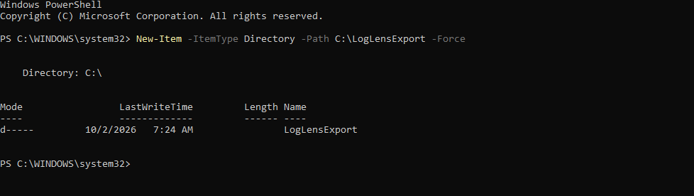
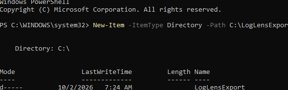
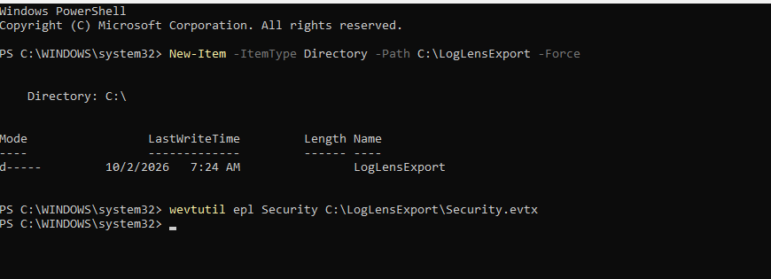
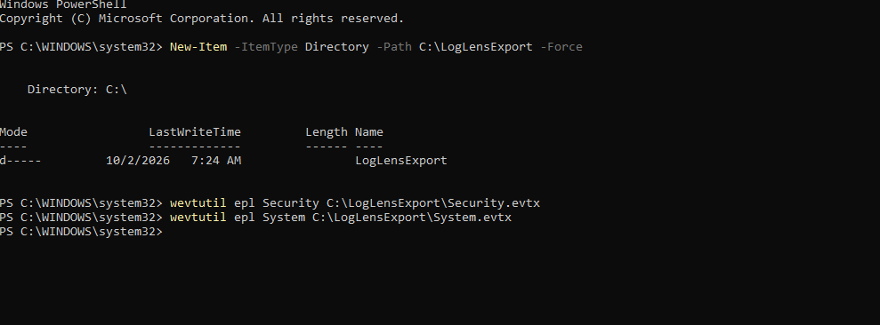
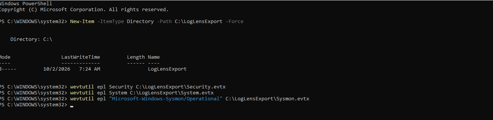

## 1. Open PowerShell as Administrator

First, I opened PowerShell with administrator privilege and searched for PowerShell from the Start menu, right-clicked it, and chose **Run as administrator**. I used administrator mode because some of the commands used to export Windows logs may require elevated permissions.


## 2. Create a Folder for the Exported Logs

Before exporting the logs, I created one folder where all of the exported files could be stored. I used `C:\LogLensExport` so that the Security, System, and Sysmon logs would all be kept in the same place.

I ran this command in PowerShell:

```powershell
New-Item -ItemType Directory -Path C:\LogLensExport -Force
```

After running the command, Windows created the `LogLensExport` folder on the C: drive.




## 3. Export the Security Log

Next, I exported the Windows Security log. This log contains security-related activity such as sign-ins, failed sign-in attempts, and account changes.

I used the following command:

```powershell
wevtutil epl Security C:\LogLensExport\Security.evtx
```

The command saved the Security log inside the export folder as `Security.evtx`.




## 4. Export the System Log

I also exported the Windows System log. LogLens can use this log for system-related events, including activity involving Windows services.

I ran:

```powershell
wevtutil epl System C:\LogLensExport\System.evtx
```

This created `System.evtx` inside the same export folder.




## 5. Export the Sysmon Log

The last log I exported was the Sysmon Operational log. Sysmon provides more detailed information about activity such as processes and network connections.

I used this command:

```powershell
wevtutil epl "Microsoft-Windows-Sysmon/Operational" C:\LogLensExport\Sysmon.evtx
```

After the command completed, `Sysmon.evtx` was saved in the `LogLensExport` folder.

If Sysmon is not installed on the computer, Windows may say that the Sysmon channel cannot be found. In that case, this log can be skipped.



## 6. Open LogLens

Once LogLens is available, the next step will be to open the application. If LogLens is being run through Docker, it can be started from the LogLens project folder using:

```powershell
docker compose up
```

The application can then be opened in a browser at `http://localhost:8501`.

**Week 1 testing note:** I could not test this step yet because the LogLens application has not been built. I will test this step and add a screenshot once the application is available.


## 7. Upload the Exported Logs

After LogLens is running, the exported log files will be uploaded through the application's upload area.

The supported files are:

- `Security.evtx`
- `System.evtx`
- `Sysmon.evtx`, if Sysmon is available

The files will be selected from `C:\LogLensExport`. LogLens is designed to process these files locally instead of sending the logs somewhere else.

**Week 1 testing note:** I could not test the upload process because the LogLens upload interface has not been built yet. However, I successfully exported all three EVTX files during my Week 1 lab testing.


## 8. Clean Up the Export Folder

After the logs have been used with LogLens, the `C:\LogLensExport` folder can be deleted if the files are no longer needed.

For my Week 1 testing, I did not delete the folder immediately because I needed the exported logs for the project's test fixtures. I copied the three EVTX files into `tests/fixtures/lab/` as required for the project.